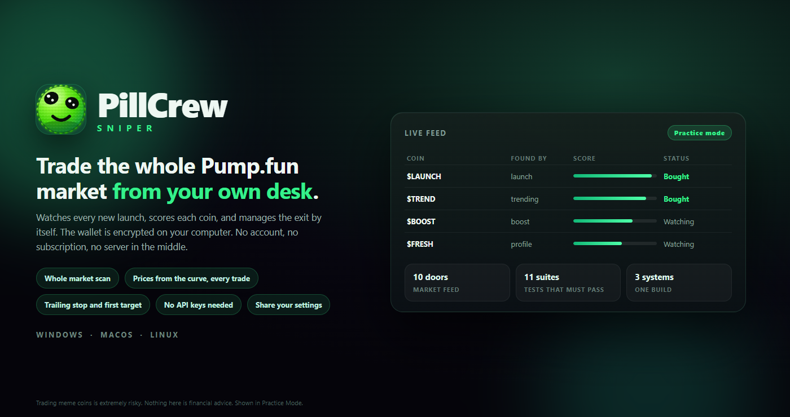
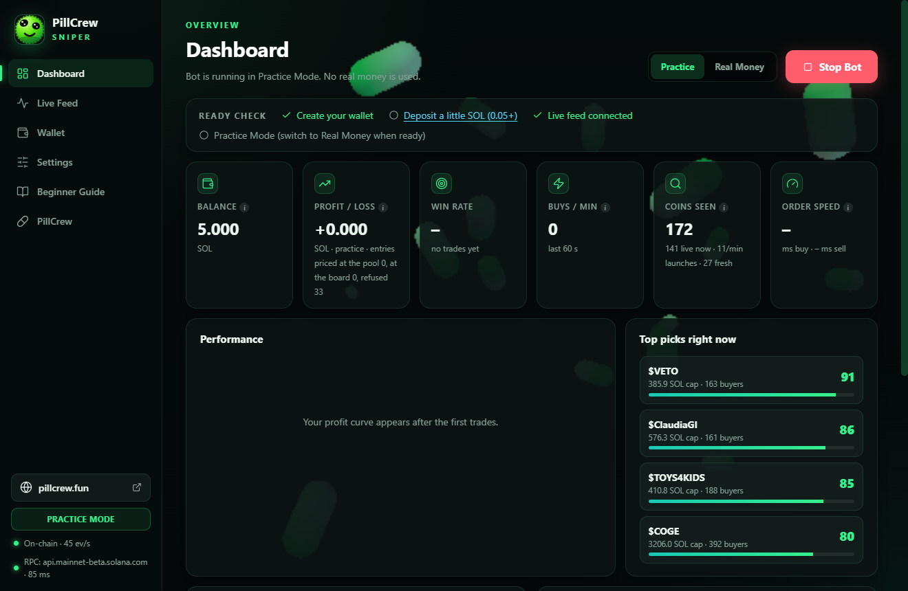
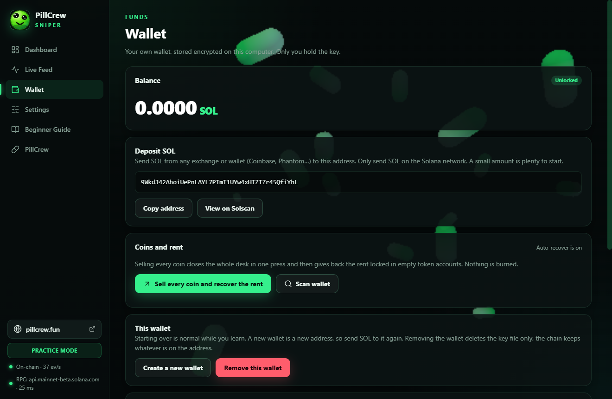
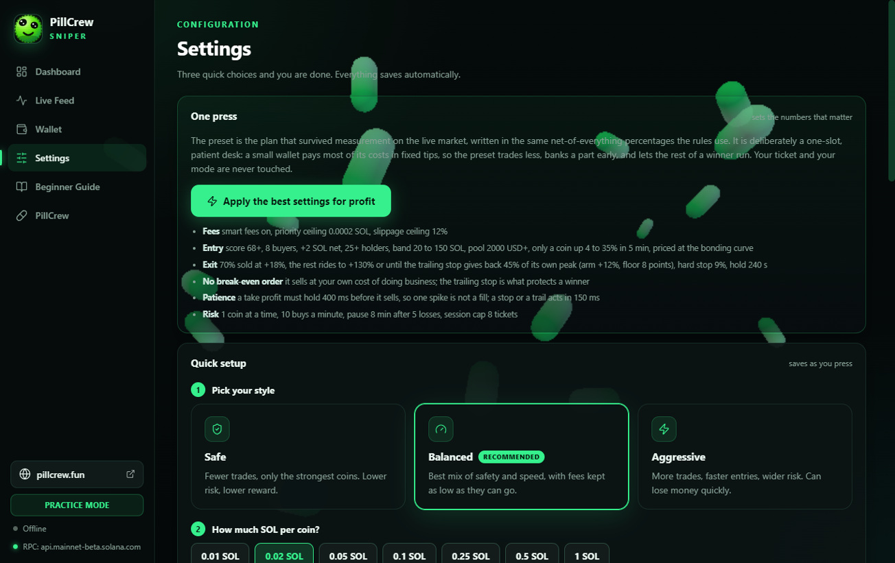

# PillCrew Sniper

**A Pump.fun trading bot you can actually use.** A real desktop app with a UI, a built-in wallet and
shareable settings - not another terminal script that needs a config file and a paid data plan.

It scans the whole new-coin market, scores every launch, buys the strong ones and manages the exit on
its own. Plain Node.js and Electron with no native modules, so the same source runs on Windows, macOS
and Linux, with an encrypted wallet that never leaves your computer.

Built for people who want to trade meme coins without babysitting a chart. No subscription, no server,
no account. Your keys stay in a file on your disk.

This is **version 1.0 - the first release**. It is maintained and updated; the roadmap already includes
a bundler-style launch tool and more, announced on [pillcrew.fun](https://pillcrew.fun).



| The dashboard | The wallet |
| --- | --- |
|  |  |

| Settings, one press presets and the settings code | |
| --- | --- |
|  | |

Every picture here is the shipped program in Practice Mode - the real window, the real market data, not
a mock-up. The wallet in the picture is a throwaway made for the screenshot.

## Why a UI, when most bots on GitHub are scripts

Search for a Pump.fun bot and you get command line tools and SDKs: a `.env` file, a JSON of wallets, a
log file to read, and a strategy you have to trust because there is nothing to look at. This one is a
program:

- **You can see what it is thinking.** Every coin it tracks is on screen with its score, its buyers, its
  net buying and the sentence that says why it was refused. The exit plan is written above the settings
  it comes from.
- **The wallet is inside it.** Create or import a Solana wallet, back it up, deposit, withdraw, sell
  everything and recover the rent locked in token accounts - without a terminal, and without pasting a
  private key into a website.
- **One press sets a working plan.** The preset tunes fees, entry bar, exit ladder and risk limits
  together, and everything it writes stays editable by hand.
- **A simple mode when you want a simple desk.** One switch shows only the basic numbers - the market
  cap band, the buyer floor and ceiling, the amount, the slots, the slippage, the target, the stop and
  the hold time - and turns every advanced rule off. Switch back and the full desk returns with nothing
  lost.
- **You never need a config file.** Settings save themselves as you press, and a forgotten key or a
  broken file is reported in plain words instead of breaking a trade.
- **You cannot get stuck holding something.** The bot keeps a reserve of exit fees that no entry may
  spend, shows exactly how much is held back, and refuses to leave a coin it cannot pay to sell.

## Everyone will be able to share their best sniper settings

Settings ends with a **Share your settings** card. It writes one code of about 170 characters:

```
PCS1~eyJ2IjoxLCJwIjoiYmFsYW5jZWQiLCJuIjpbNjgsOCwyLDIwLDE1MCwyMDAwLDMsNDUsMC4wMiwxLDEwLDEzMCw5LDI0MCwxOCw3MCwwLDEyLDgsNDAwLDEyLDAuMDAwMiwwLjM1LDUsOCwzLDMwLDQwLDM1LDQsMjUsMSwwLDBdfQ~j2
```

Post it on X.com, someone pastes it into their app and gets your entry bar, your whole exit ladder, your
size and pace - the plan, not a screenshot of it. That is the point: the good settings spread, instead of
everybody guessing at the defaults.

What a code can never carry: no API keys, no RPC URL, no wallet, no mode and no open positions. The
payload is a version, a style name and a list of numbers, a checksum refuses a code that was mistyped or
cut short, and applying one never raises your ticket above the one you already set.

## Why this bot

Most Pump.fun bots need a paid data plan before they see a single trade. This one starts working on a
clean install with no API keys at all:

| What | Without any key | With a free PumpDev key |
| --- | --- | --- |
| New launches | Yes | Yes |
| Prices per coin | Market feed, plus the bonding curve for the coins it holds | Every trade on the twenty coins it watches |
| Trending and boosted coins | Yes | Yes |
| Trade execution | Yes | Yes |

The twenty is not a paywall: a free PumpDev plan allows 25 live subscriptions per address, so the bot
spends that budget on open positions and the best candidates.

Optional keys only make it faster. Nothing in the app is locked behind a paywall.

## How fast it is - and what it is not

- **From a price to a signed order:** the trade stream prices a held coin the moment a trade arrives, the
  decision loop runs every 50 ms, and the signed bytes go to three RPC nodes at once. Measured on chain:
  buys land **168 ms** after the decision, sells **163-419 ms**. Waits overlap, they do not add up: an entry
  builds its order while the pool price is still being checked (and a refused coin is discarded before the
  wire), an urgent exit asks both routes at once and the first signed transaction wins, and a buy asks the
  chain while the wallet balance is still being read.
- **The price of a held coin is the pool's own reserves**, read at `processed` - the freshest state a node
  serves - one request for every coin held, every 120 ms.
- **Jito bundles, optional (no key):** every signed trade is also offered to Jito's block engine as a bundle
  with a tip. A bundle lands whole or not at all, so the tip is paid **only when it lands** - and the normal
  route still has the same bytes, so a lost auction costs nothing. Measured against the real block engine:
  its tip accounts answer in **219 ms**, and a signed bundle submitted from this client came back with a
  bundle id; the tip is checked instruction by instruction (one transfer, to one of Jito's own accounts, at
  least 1000 lamports) before it is signed.
- **What this is not:** a co-located Rust bot on a shred stream. Those see the chain slightly before a
  websocket feed does, and they can win a slot this app cannot win from a home connection. That needs a gRPC
  provider and a different budget. What this app does better is everything around the order: rules you can
  see, a wallet that can never be left unable to sell, and settings you can hand to somebody else.

## What it does

1. **Watches the market.** New launches are polled on every cycle, alongside nine rotating doors: boosted
   coins (latest and top), fresh token profiles, trending coins, most traded coins, every pool on the
   Pump.fun dex, trending pools, the DexScreener search board and GeckoTerminal's newest pools. That is
   ten sources of new coins, and 150-220 coins tracked in a normal session.
2. **Prices what it finds.** Up to 30 coins per request from the market board, and a coin it holds is
   priced at its own bonding curve - the same number the buy was priced at - with a quote only while that
   stream is quiet, so an exit never reads a stale number.
3. **Scores each coin from 0 to 100.** Buy pressure, net flow, price change, how many wallets are
   buying, whether one wallet is doing all the buying, creator behaviour, market cap band, pool depth.
   The reason a coin was refused is written next to it.
4. **Buys the ones that pass.** One ticket per coin, a hard cap on how many positions and how many
   buys per minute, a check that the wallet really holds the SOL before the order is built, and a
   reserve of exit fees that no entry may touch.
5. **Manages the exit.** First rung, take profit, trailing stop after the coin runs, hard stop loss,
   creator sold, time limit - all of them measured net of the round trip. Smart fees pay less when the
   network is quiet and more when an exit must land.
6. **Recovers the rent.** Every token account locks about 0.00204 SOL. Every sale ends by selling the
   leftover, closing the account and returning that rent; one press in the Wallet tab sells every coin
   the wallet holds and closes whatever is left.

## Run it on your machine

You need [Node.js 20 or newer](https://nodejs.org) and nothing else. There is no installer and no
released build yet: clone the repository and run it from source.

```bash
git clone https://github.com/PillCrew/pillcrew-sniper.git
cd pillcrew-sniper
npm install
npm start
```

`npm install` fetches Electron, about 100 MB on the first run.

### Windows

```powershell
node --version            # must print v20 or newer
npm install
npm start
```

If PowerShell refuses to run `npm` with a script error, run `Set-ExecutionPolicy -Scope Process Bypass`
in that window first, or use Command Prompt. The app keeps its files in `%APPDATA%\PillCrew Sniper`.

### macOS

```bash
node --version
npm install
npm start
```

The app keeps its files in `~/Library/Application Support/PillCrew Sniper`. It uses no native modules and
no Apple-only APIs, so it runs wherever Electron runs, but no build has been started on a Mac yet: treat
the first run there as unverified.

### Linux

```bash
node --version
npm install
npm start
```

Some distributions need the usual Electron libraries before a window can open:

```bash
sudo apt install libgtk-3-0 libnotify4 libnss3 libxss1 libasound2 libxtst6 xdg-utils
```

On Wayland, if the window comes up blank, start it with `npm start -- --ozone-platform=wayland` or use
X11. The app keeps its files in `~/.config/PillCrew Sniper`. The test suite runs on Linux in CI; the
window itself has only been driven on Windows so far.

### First run

1. The app opens in **Practice Mode** with 5 fake SOL. Press **Start** and watch it trade.
2. Open **Wallet**, create a wallet with a password you will remember, and copy the address.
3. Send a small amount of SOL to that address. Five dollars is enough to learn on.
4. Back up the private key before you switch to real money (Wallet, Show private key).
5. Switch to **Real Money**, accept the risk notice, press Start.

None of that needs an API key.

## Prove it works before you deposit

```bash
npm test                      # eleven suites, offline, no network
PILLCREW_PASSWORD=... node test/live-dryrun.js
```

`test/live-dryrun.js` builds a real buy, a real sell, a withdrawal and an account close with the same
code the bot uses, inspects them with the same guards, signs them with the wallet in the app folder and
then **simulates** them on mainnet. Nothing is spent. On an empty wallet every step answers
`AccountNotFound`, which is the cluster saying the fee payer does not exist yet: that is the last thing a
funded wallet fixes.

## Read the session afterwards

Every line the window shows is also written to a diary on your disk, one file per day:

| System | Folder |
| --- | --- |
| Windows | `%APPDATA%\PillCrew Sniper\logs\pillcrew-<date>.log` |
| macOS | `~/Library/Application Support/PillCrew Sniper/logs/` |
| Linux | `~/.config/PillCrew Sniper/logs/` |

Buys, sells, the rule that fired, the numbers it fired on, refusals with their reason, feed changes and
errors. Nothing leaves your machine.


## Modes

**Practice Mode** uses fake SOL. Same rules, same market data, same fills model, no money at risk.
Use it until you have watched a full session and understand why each trade happened.

**Real Money** signs transactions with your wallet on this machine. It requires an unlocked wallet, a
backed up private key and an explicit confirmation in Settings.

The wallet keeps **0.002 SOL aside for the exits**, and it will not buy below the rent-exempt minimum
(0.00089 SOL): a wallet under that floor cannot be debited at all, so a coin bought with the last lamports
could never be sold again - by this bot, by Jupiter, or by any swap widget. If the balance does drop that low,
the Wallet tab says so and names the address to top up.

## How a coin gets bought

Every entry has to clear all of these:

- Market cap inside the profile band, and the pool is not empty
- Enough buys in the recent window for the profile
- Positive net buying, not a single wallet buying against itself
- At least the holder bar, when the extra entry filters are on: distribution is the slow signal that
  separates a coin people are in from a coin only its creator is in
- Price is moving up, not falling
- Creator has not sold, and did not buy a huge bag at launch
- Token is not flagged, cannot be frozen, and enough wallets are involved

When a rule fails the coin stays on the list with the reason, so the market teaches you instead of the
log shouting codes.

## How a position gets closed

- **First rung**: 70% of the position is banked at the first real move (Balanced and the preset: +18% net). Measured
  over several sessions, a coin that reaches +20% comes back more often than it runs, so the rung is the win
- **Take profit** only for a moon shot (Balanced: +90%, the preset: +130%); everything else is closed by the trail
- **Trailing stop** once the coin has run: it follows the peak and gives back **45% of that peak** (arm +12%, floor 8
  points), so a coin up 100% is not sold by a 15-point wobble - and a small peak is still protected tightly
- **Stop loss** on the hard limit, confirmed by a second price reading so one bad quote cannot fire it
- **Creator sold** the moment the creator's own sell is seen
- **Time limit** when nothing happens

The trail is the one number that decides whether the desk can pay for its losers. Measured in paper with a fixed
4-point give-back, every profit rule in a session closed between +6% and +12% while the losses filled at -21% to
-33%; the room a runner gets is now proportional to the run it has had.

Every percentage is **net of the whole round trip** - the protocol both ways plus both tips - so "+12%"
means the trade is really 12% ahead, not 12% before it paid for itself. That is why no style carries a
break-even rule any more: at a net zero the trade has paid its costs and earned nothing, the fill lands
under the reading, and the rule pre-empts the trailing stop, which sells above water by construction.

A price rule has to hold before it acts: the level must be seen again after `triggerHoldMs` (400 ms by
default) on a fresh price, so a spike that lives for one tick is not a fill. A take profit that has
already slipped back to break-even when the order is ready is abandoned instead of sold - a winner is
never closed at a loss. Every sale line names the rule and the move that fired it, and the move that
filled when the two differ (`Take profit at +70.1%, filled at -5.2%`). The row of a closed trade also keeps
the best it was worth (`peaked +41%`) and how long it was held, so an exit that was too early is visible
instead of forgotten.

An exit that is still in profit is never handed a wide slippage tolerance: it gets 15%, because a 40% order on a
coin that is +8% may fill at -32% - which is exactly the "it was up and it sold me a loss" report. A losing exit
keeps the wide tolerance, because any price beats no sale.

**A price that stopped arriving is treated as a price that stopped arriving.** A fall is taken on the first reading,
however big; a jump up still has to be seen twice. A position nobody is pricing is asked for directly after ten
seconds and sold after forty-five (`Price lost`), because a coin the desk cannot see is a coin it cannot protect, and
the card names the age of its number (`· no price 12s`) so a still percentage can never look live.

Every sale then sells the leftover, closes the coin's token account and returns its ~0.00204 SOL of rent.

## Settings that matter

| Setting | What it does |
| --- | --- |
| One press | Applies the tuned set of numbers below in a single click |
| Style (Safe, Balanced, Aggressive) | Sets the whole rule set: buyer bar, market cap band, target, stop, hold time, fees |
| Buy amount per coin | SOL spent per entry. The single most important number |
| Max coins held | How many positions may be open at once |
| Max buys per minute | Speed cap |
| Daily loss limit | The bot stops itself when the session loses this much |
| First take profit at, how much to sell | Banks part of the position early and lets the rest run. `0` turns the first rung off |
| A signal must hold for (ms) | How long a take profit or a stop must be seen before it sells. The safeguard against a one-tick spike |
| Trailing stop arms at, gives back | Protects a runner without capping it |
| Break even after a peak | Off in every style. A break-even order sells at the round trip's own cost, and the trailing stop protects a winner better |
| Pause after losses in a row | Rests instead of bleeding through a cold streak |
| Slippage ceiling, priority fee ceiling | Smart fees stays under these unless an exit must land |

The preset writes a ticket that fits the session limit, so one bad coin cannot end the session. Every
value it writes is still editable by hand. Practice and real money keep separate statistics, and each
book can be cleared on its own in Settings.

The full list, with defaults per style, is in [docs/SETTINGS.md](docs/SETTINGS.md).

## Integrations, all optional

- **PumpDev** (free) turns on the live trade stream. Without it the bot still trades, using market
  prices that refresh about once a second.
- **Jito** (no key, off by default) offers every signed trade to the block engine's auction as a bundle
  with a tip that is paid only when the bundle lands. It never replaces the normal route: the same bytes
  still go to the RPC nodes, so the worst case is a lost auction that costs nothing. The tip is a setting
  (`Jito tip per trade`), and the counter for spent fees never counts a tip that was not paid.
- **Jupiter** adds a discovery door and, with a free key, a backup swap route if the main route fails.
  The backup swap route itself needs no key: it is there on a fresh install.
- **Sol Incinerator** burns leftover tokens and closes their accounts. Closing empty accounts is free
  and local, without any key, and so is selling a leftover balance instead of burning it.
- **Private RPC** (Helius, QuickNode, Triton) makes every read and every send faster.

Keys are stored in your local settings file and are only ever sent to the service they belong to.

## Safety

- The wallet is encrypted with AES-256-GCM and a scrypt derived key, in the app data folder, written
  atomically so a crash cannot leave half a key.
- The private key is printed only when you ask for it and re-enter your password.
- Every trade transaction is inspected before signing. A transaction that tries to move more SOL out
  than the trade needs is refused, and so is any transaction built by a third party that tries to move
  a token, grant an approval or pay the rent somewhere else.
- A position is open from the moment the signed bytes are sent, so its stop and target work while the
  chain is still confirming. Confirmation separates a rejection from a missing answer, so a busy RPC
  cannot make the bot buy the same coin twice.
- Every sale is booked from the wallet balance, not from the request: a fill that sells half of what was
  asked leaves the other half as a position and books exactly what left.
- Open real positions are saved and picked up again on the next start.
- Real money mode needs an unlock, a backed up key and a confirmation. The wallet cannot be locked or
  drained while positions are open, and closing the window with real positions asks first.
- The app never sends your key anywhere. There is no telemetry.

## Build installers

There is no GitHub Release and no download link yet: this repository is the source of truth, and a build
is made on the machine of whoever needs one. Run it from source, or build the installers yourself:

```
npm run dist:win     # NSIS installer, run on Windows
npm run dist:mac     # DMG, run on macOS
npm run dist:linux   # AppImage and deb, run on Linux
```

The `package` job in `.github/workflows/ci.yml` builds all three on demand (Actions, `workflow_dispatch`)
and keeps them as artifacts, which is also the proof that the cross-platform promise is real. Build notes,
the dependency pin Electron needs, the icon and the `--publish never` rule are in [docs/BUILD.md](docs/BUILD.md).

None of these installers are code signed, so Windows shows a SmartScreen warning and macOS needs the
app allowed in Security settings. A certificate removes both; `docs/BUILD.md` says which variables to set.

## Tests

```
npm test
```

Eleven suites: RPC failover and its time budgets, the on-chain decoder, a smoke pass over the defaults,
the engine trade cycle and the
feed wiring (build retries, late landings, the Jupiter backup), the market scanner and its doors, the
exit rules and the statistics books, the guards around foreign transactions,
the wallet and selling everything (adoption, sell-all, one holding, the start gate), the settings code,
the bonding curve reader (layout, sanity guard, entry pricing) and the Jito lane (tip accounts, the
bundle payload, the tip whitelist and floor, and a Jito that is
down not being allowed to touch a trade).
All offline, with mocked endpoints and a real keypair where a transaction has to be built and inspected.

GitHub Actions runs them on Windows and Ubuntu for every push.

What has also been run against the live market with real money, three minutes with the shipped defaults:
six buys, eight exits, every exit rule fired at least once, and each sale line naming the rule and the
move it fired at (`Sold 50% of X (Take profit part 1 at +13.4%)`, `Sold Y (Trailing stop at +6.1%)`). Zero
token accounts were left in the wallet afterwards: every sale closed its own account and returned the
rent.

## License

[MIT](LICENSE). Use it, fork it, build on it - credit PillCrew.

## Disclaimer

Trading meme coins is extremely risky. Most coins go to zero. This software is a tool, not advice, and
it cannot make a bad market good. Trade only with money you can afford to lose.

