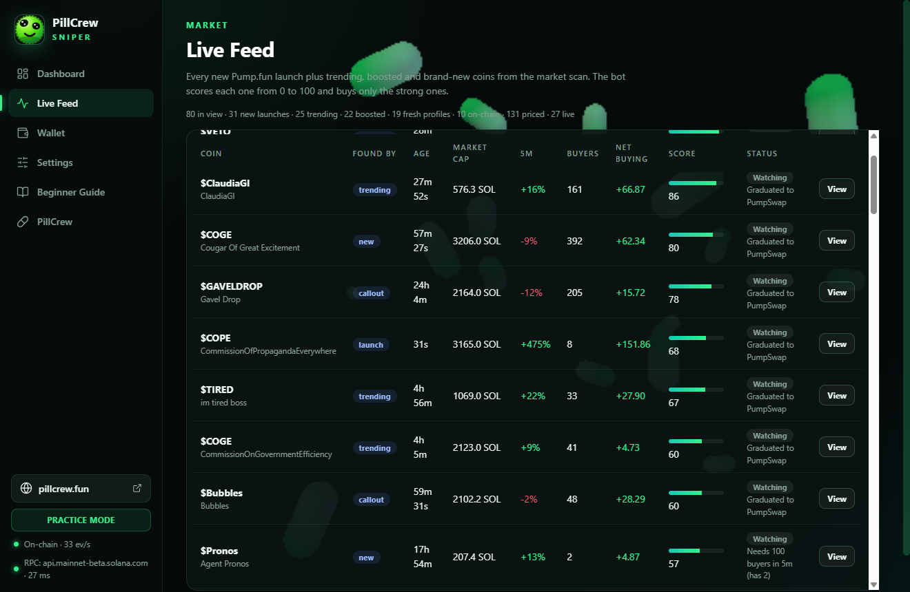

# PillCrew Sniper


**A Pump.fun trading bot you can actually use.** A real desktop app with a window, a wallet inside it and a plan you
can read — not another terminal script behind a `.env` file and a paid data plan.

[](https://github.com/PillCrew/pillcrew-sniper/actions/workflows/ci.yml)
[](LICENSE)
[](https://nodejs.org/)


It watches every new coin on Pump.fun and PumpSwap, scores each one from 0 to 100, buys the strong ones and manages
the exit on its own — take profit, stop loss, trailing exits, holding limits. Everything runs on your computer:
no account, no server, no subscription, and your wallet key never leaves the machine.

> **Trade small while you learn.** Practice Mode is free and uses fake SOL. Meme coins are extremely risky; most lose
> value. Only trade what you can afford to lose.

## Install

| Platform | Command / file |
| --- | --- |
| **Windows 10/11** | `PillCrew-Sniper-<version>-win-x64.exe` — installs for your user, no admin rights |
| **macOS 12+** | `PillCrew-Sniper-<version>-mac-arm64.dmg` (Apple silicon) or `…-mac-x64.dmg` (Intel) |
| **Linux x64** | `PillCrew-Sniper-<version>-linux-x86_64.AppImage` or `…-linux-amd64.deb` |

Prebuilt installers are published on the
[releases page](https://github.com/PillCrew/pillcrew-sniper/releases). The first public release goes out after the
testing rounds, so if that page is still empty, use the source route below — or build the package yourself in one
command ([docs/BUILD.md](docs/BUILD.md)). Unsigned builds need one click through SmartScreen on Windows, or one
right-click → Open on macOS.

### Run from source (all three systems)

Node.js **22 or newer**, nothing else — the app has no native modules to compile.

```sh
git clone https://github.com/PillCrew/pillcrew-sniper.git
cd pillcrew-sniper
npm ci
npm start
```

`npm ci` downloads Electron once (~100 MB) and copies three.js into `renderer/vendor`. The FUSE requirement on Linux,
the macOS quarantine flag, Wayland scaling, the hidden-window smoke test and every common error are covered in
**[docs/INSTALL.md](docs/INSTALL.md)**.

## What it looks like

| The dashboard | The live feed |
| --- | --- |
|  |  |

| The wallet | Settings and presets |
| --- | --- |
|  |  |

Every picture is the shipped program in Practice Mode — the real window, the real market data, not a mock-up. The
wallet in the picture was created for the screenshot and deleted with the profile it lived in.

## First run — five steps

1. The app opens in **Practice Mode** with 5.000 fake SOL. Press **Start Bot** and watch it work; nothing real is at
   risk.
2. **Wallet → Create your wallet**, and choose a password. It encrypts the key on this computer (AES-256-GCM, scrypt).
3. **Export the private key and keep it offline.** Without the key and the password the funds cannot be recovered —
   by us or by anyone.
4. Deposit a **small** amount of SOL, switch to **Real Money**, and keep the ticket small until you have seen real
   exits land.
5. Optional: **Settings → your own keys** for a private RPC, PumpDev, Jupiter or Sol Incinerator.

## Why this one, when the market is full of scripts

| | |
| --- | --- |
| **You can see it think** | Every tracked coin is on screen with its score, buyers, net buying and the sentence that says why it was refused. When slots are free, the Activity log counts the reasons once a minute, so a quiet book is a decision and not a mystery. |
| **The wallet is inside** | Create, import, back up, deposit, withdraw, sell everything, recover the rent locked in empty token accounts — without a terminal and without pasting a key into a website. |
| **One press sets a working plan** | *Best Profit* writes a full preset (entry bar, exit ladder, exposure limits) and **stops there** — it never starts the bot for you. Everything it writes stays editable. |
| **Fast where it matters** | A coin that traded in the last 1.2 s is already priced from its own tape, so an entry reaches the order in about a quarter of a second instead of more than a second. Coins are judged four times a second; exits are measured forty times a second. |
| **Honest books** | Practice results and real trades are separate ledgers. A measured exit uses the wallet's own SOL delta from the confirmed sale. |
| **Bring your own endpoints** | FluxRPC, Helius, any Solana RPC plus a separate WebSocket, PumpDev, Jupiter, Sol Incinerator. All optional, all stored locally, none ever put in a settings code. |

## How it compares

[**docs/COMPARISON.md**](docs/COMPARISON.md) puts this app next to the popular open-source pump.fun bots (Chainstack,
Dexoryn, M8S, Dorado, Ferris, AllenHark) capability by capability, and names where we lose instead of hiding it.

The short version: this is the only desktop product on that list — a window, a wallet inside it, Practice Mode,
presets and a CI suite. Its feed can be pointed at a **Geyser-class transaction stream** from your own provider, which
is the same program data closer to the validator; what it does not have is the binary Yellowstone gRPC client or Jito
ShredStream, and this README will not pretend otherwise. Nobody on either side of that table has a verified profit
figure.

## What is included

- **Feeds** — Pump.fun program-log WebSocket decoding, **a Geyser-class transaction stream from your own provider**
  (`geyserUrl`), PumpPortal, optional PumpDev, plus market discovery from the boards, with fallback between doors and a
  named reason when one is rate limited.
- **Entries** — scoring, creator-sale detection, wallet concentration, mint/freeze authority checks on chain, token
  2022 screening, coin-age clocks, buyer and net-flow bars, per-minute pace and slot limits, and **copy trading**: type
  a wallet in Settings and its next buy is entered at once, still through every money guard.
- **Exits** — take profit (with partials), stop loss, trailing stop, peak give-back, break-even, holding limit, "price
  lost" and an adaptive order-flow exit.
- **Money** — pump.fun bonding curve and PumpSwap pools, tips and priority fees with a round-trip cost gate, Jito
  bundle path for crowded slots, the same signed transaction broadcast to several RPCs, unknown outcomes kept and
  checked by signature instead of being re-ordered.
- **Wallet** — local AES-256-GCM encryption with scrypt, sandboxed renderer with context isolation and a strict CSP,
  guarded IPC, transaction inspection before signing, fee ceilings, withdraw and rent recovery.
- **Study** — Practice Mode with depth-aware fills, latency and failures; recorded-signal replay with win rate, profit
  factor and drawdown; opt-in local market recording.

## Your own keys

All of these are optional and stay in `settings.json` on your own disk:

| Setting | What it buys you |
| --- | --- |
| `rpcUrl` / `rpcBackupUrl` / `rpcWsUrl` | A private node and socket: lower latency, fewer rate limits, and automatic failover between the two |
| `pumpdevKey` | PumpDev's trade stream instead of the public one |
| `jupiterKey` | A higher Jupiter price quota for the market scan |
| `incineratorKey` | Bulk closure of empty token accounts |
| `copyWallets` | One or more addresses to follow: their next **buy** is entered at once, past the score and buyer bars, through the usual money guards. Their sells are not mirrored |
| `geyserUrl` / `geyserToken` | A Geyser-class transaction stream from your provider (`wss://` or `https://`, token appended as `?api-key=`). Faster than the public program-log feed; the desk falls back on its own if it stops answering |

## Tests

```sh
npm test          # 13 node suites: rpc, chain, smoke, engine modules, market, exits, guards, wallet, settings sharing, Jito, curve, copy trading, audit
npm run test:ui   # Electron, hidden window, mock wallet, engine stopped
```

Every push runs both on **Windows and Ubuntu** through GitHub Actions. Nothing in the suite touches your wallet or real
money, and every market, Jito and RPC call is stubbed; the separate `test/live-dryrun.js` script does talk to the
network and is never part of `npm test`.

## Build your own installers

```sh
npm run dist:win     # Windows  → dist/PillCrew-Sniper-<version>-win-x64.exe
npm run dist:mac     # macOS    → dist/PillCrew-Sniper-<version>-mac-<arch>.dmg   (build on a Mac)
npm run dist:linux   # Linux    → dist/PillCrew-Sniper-<version>-linux-<arch>.{AppImage,deb}
```

Build each target on its own system; a Mac bundle cannot be produced or signed from Windows or Linux. Code signing and
notarization are described in **[docs/BUILD.md](docs/BUILD.md)**.

## Documentation

| | |
| --- | --- |
| [Install and run](docs/INSTALL.md) | Exact steps and fixes for Windows, macOS and Linux |
| [Comparison](docs/COMPARISON.md) | Capability by capability against the other open-source pump.fun bots, including where we lose |
| [Measured latency](docs/LATENCY.md) | What the feed actually receives on a real machine, with the script that measured it |
| [Settings reference](docs/SETTINGS.md) | Every number the app has, what it does, and why the percentages are net |
| [Architecture](docs/ARCHITECTURE.md) | How the engine, feeds and safety layers fit together |
| [Backtesting](docs/BACKTESTING.md) | Replaying a recorded session |
| [Build and release](docs/BUILD.md) | Installers, signing, packaging notes |
| [Changelog](CHANGELOG.md) | What changed, release by release |
| [Security policy](SECURITY.md) | Trust boundaries, and what the guards do not prove |

## Contributing

Issues and pull requests are welcome — [CONTRIBUTING.md](CONTRIBUTING.md) has the ground rules. A change that can
spend SOL needs a test that fails without it. Please report vulnerabilities privately through a GitHub security
advisory rather than in a public issue.

## What this is not

There is no verified profitability figure and no latency ranking against other bots, and a strategy preset is not a
promise. The app does not index creator history or cluster wallets, does not use Geyser/ShredStream, and its replay is
not a full historical simulation of live discovery. A stop can gap past its level or find no liquidity. RPCs and
market services can lag or lie. Use a small, separately funded wallet.

## Licence

MIT — see [LICENSE](LICENSE). Built by [PillCrew](https://pillcrew.fun).
